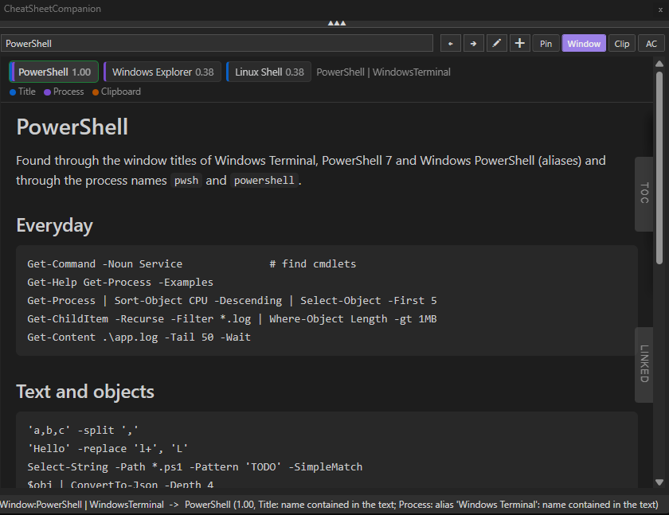
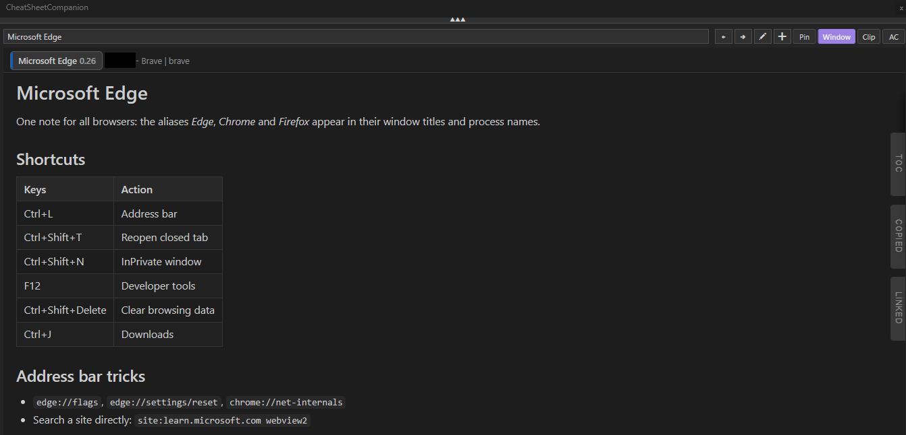
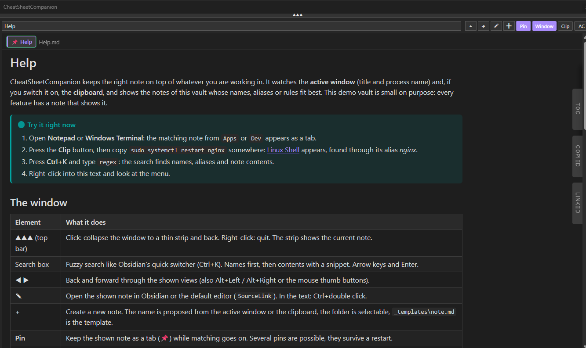

# CheatSheetCompanion

*Deutsche Version: [README.md](README.md)*

## About

CheatSheetCompanion shows notes from a Markdown folder or Obsidian vault depending on what you are working in.
The matching note is found through the similarity between the note name and

- the title of the active window,
- the process name of the active window, or
- the text copied last (clipboard, for example from RDP or SSH sessions).

The best candidates (`MaxCandidates`, default 5) are shown as tabs with their similarity score (0.00 to 1.00).

## Screenshots

Windows Terminal is active: the note *PowerShell* is found through its alias (1.00), two more candidates wait as tabs, the status line explains the match.



A browser (Brave here) is active: the note *Microsoft Edge* covers all browsers through aliases.



Pinned note (📌) with callout, table and the TOC, COPIED and LINKED panels at the right edge.



## Requirements

- PowerShell 7 x64 ([download](https://github.com/PowerShell/PowerShell))
- WebView2 Runtime (preinstalled on Windows 11, otherwise the [Evergreen Runtime](https://developer.microsoft.com/microsoft-edge/webview2/))
- The WebView2 libraries ship in the `dll\` folder.

## Start

```powershell
pwsh -NoProfile -ExecutionPolicy Bypass -File .\CheatSheetCompanion.ps1
```

Nothing else is needed: `ini\config.ini` points to the bundled demo vault `vault\`, which shows every feature and contains the
manual as the note *Help* (open Notepad, Windows Terminal or a browser and the matching note appears).
For your own vault set `MarkDownFolder` in `ini\config.ini` to the folder (absolute or relative to the script) and, if needed,
`Language` (default `auto` = Windows display language).

Options:

| Parameter | Meaning |
| --- | --- |
| `-OpenNote "Name"` | Shows this note right after start-up. |
| `-Verbose` | Writes a detailed log to `%LocalAppData%\CheatSheetCompanion\csc.log`. |
| `-AutoCloseSeconds n` | Test helper: closes the window after n seconds. |
| `-ScreenshotPath path.png` | Test helper: saves the rendered page as PNG (`*.window.png` = whole window). |
| `-SearchQuery "text"` | Test helper: fills the search box and opens the result list. |

## Usage

| Element | Function |
| --- | --- |
| Top bar (▲▲▲) | Click: collapse the window to a thin strip and back. Right-click: quit. |
| Search box (Ctrl+K) | Fuzzy search like Obsidian's quick switcher: names first, then contents with a text snippet. Arrow keys select, Enter opens, Escape closes. |
| ◀ ▶ | Back and forward through the views (also Alt+Left / Alt+Right or the mouse thumb buttons). |
| Tabs | Switch candidates by click, Ctrl+1 to Ctrl+9 or Ctrl+Tab / Ctrl+Shift+Tab. |
| ✎ | Open the shown note in Obsidian or the default editor. In the text: Ctrl+double click (`EditOnDoubleClick`); a plain double click only selects the word. |
| + | Create a new note. The dialog proposes the name from the most recent source (window title, clipboard or selection in the companion), switchable, hard-trimmed to `NewNoteNameMaxChars`. Clipboard or selection can become the content, the target folder is selectable (default `NewNoteFolder`), `NewNoteTemplate` supplies the template. |
| Code block | Hovering shows *Copy* at the top right: copies the whole block without selecting. |
| COPIED (right edge) | Slide-out panel like the TOC with everything copied through the companion (code block, selection, Auto Copy, context menu), `CopyHistory` entries, default 10. One click copies an entry again and closes the panel; a click elsewhere, Escape or switching windows close it as well (same for the TOC). The panel only appears when there are entries and survives a restart (`state.json`, see below); *Clear* in the panel deletes the history. |
| No match | Default: the shown note stays, the status line reports the missing match. With `NoMatchBehavior = suggest` the page "No note for this yet" appears instead, with a *Create note* button and the closest notes. |
| Start page | Shows the recently shown notes of the vault (`RecentNotes`). |
| **Pin** | Pin the shown note, several possible: pinned notes stay as colour-marked tabs (📌) at the front, matching goes on and the best match is shown as usual. `MaxCandidates` is the total, one slot always stays for matches. The button shows whether the visible note is pinned. Survives a restart (also in the tray menu and context menu). |
| **Window** | Show notes matching the active window (title and process). |
| **Clip** | Show notes matching the copied text. A note found this way stays as long as you remain in the program you copied from (title changes in terminals and editors do not override it); switching programs returns to window mode. |
| **AC** | Auto Copy: copy the selected text when the mouse button is released, if it was held for at least `AutoCopyMinHoldMs` (0 = immediately). |
| Right-click in the note text | Own entries at the top of the browser context menu: *Copy to clipboard* (with a selection, plain text), *Copy as…* (selection formatted, whole note as text or formatted; formatted = HTML plus text so Teams and Outlook keep lists and code blocks, also Ctrl+Shift+C), *Edit note*, *Append clipboard to note* (the copied text is written as is to the end of the shown note, for example meeting notes or a paragraph from a web page), *Add alias* (window title, process name, clipboard, selection or your own text as an alias in the front matter of the shown note), *Look up clipboard* (once, even with Clip switched off), *Pin note*, *Theme* and, with several vaults, *Vault*. |
| Tab tooltip / status line | Match reason (`ShowMatchReason`): name contained in the text, similar word of the title, alias or rule. |
| Collapsed strip | Shows the name of the current note with its score, with a hint when pinned. |
| Click on a tag | Searches the tag in all notes. |
| TOC | Show or hide the table of contents of the active note. |
| LINKED (right edge) | Slide-out panel like the TOC with the linked mentions as in Obsidian: notes that link to the active note via `[[wikilink]]`, embed or Markdown link, with the line of the mention (code blocks do not count). Click opens the note. The handle only appears when there are backlinks; `ShowBacklinks = false` turns it off. |
| Transparency | `InactiveOpacity` makes the window see-through while another program is active, so you can see what lies beneath. Under the mouse, collapsed or with the search open it is fully visible again; `0` turns it off, `WindowOpacity` is the normal opacity. |
| Tray icon | Left click: collapse or expand. Right-click: show, search, pin, the three switches, quit. |

Global hotkeys (see `ini\config.ini`): collapse or expand the window, window mode, clipboard mode, search, one-shot clipboard lookup.

### Language

All texts of the user interface (buttons, status line, menus, dialogs, pages) come from `lang\<code>.ini`. `de.ini` and `en.ini`
ship with the program; `Language = auto` takes the Windows display language, otherwise `de`, `en` or your own code. For another
language copy `lang\de.ini` to `lang\fr.ini`, translate it and set `Language = fr`. Missing keys fall back to the built-in German
texts, `{0}`, `{1}` are placeholders, `\n` is a line break. Log and configuration stay as they are.

## Rendering (Obsidian)

Supported are wikilinks `[[Note]]`, `[[Note#Heading|Alias]]`, embeds `![[image.png|300]]` and `![[Note]]`,
callouts `> [!warning]- Title`, tags `#tag`, highlights `==text==`, comments `%% %%`, YAML front matter
(optionally as a box with `ShowFrontmatter = true`), tables, task lists, footnotes, syntax highlighting in code blocks
(highlight.js) and soft line breaks as in Obsidian (switch off with `StrictLineBreaks = true`).

Internal links open in the companion. Images and relative paths are resolved against the vault
(exact path first, then relative to the note, then the shortest path with the same file name, as in Obsidian).
The *LINKED* panel at the right edge lists the notes that link to the active note (`ShowBacklinks`).

### Themes

`Theme = auto` follows the Windows mode (light or dark), alternatively `light`, `dark` or the file name of your own theme
from `themes\` (e.g. `github`). Switch with right-click > Theme; the choice is saved. A theme only overrides the CSS
variables from `assets\app.css` (see `themes\dark.css` as a template). Your own fine-tuning belongs in `styles\userstyle.css`,
which is loaded last. The window chrome follows the theme.

## Configuration (`ini\config.ini`)

```ini
[GlobalShortcut]
AutoSwitch = ControlKey,ShiftKey,F2        ; toggle window mode
DisplayCompanion = ControlKey,ShiftKey,F11 ; collapse / expand the window
ClipboardSwitch = ControlKey,ShiftKey,F3   ; toggle clipboard mode
Search =                                   ; focus the search (empty = no global hotkey, Ctrl+K in the window always works)
ClipboardLookup =                          ; one-shot lookup of the clipboard, independent of the Clip switch

[Configuration]
MarkDownFolder = vault                             ; default vault, absolute or relative to the script folder (default: demo vault)
SourceLink = obsidian://open?vault={1}&file={0}    ; {0} = note path without .md, {1} = vault name; empty = default program
NewNoteFolder = Inbox                              ; subfolder for new notes (empty = vault root)
NewNoteTemplate = _templates\note.md               ; template: {{title}}, {{date}}, {{time}}, {{content}}; Templater dates are replaced, other <% %> removed
NewNoteNameMaxChars = 60                           ; hard limit for the proposed name
IgnoreFolders = _templates                         ; in addition to .obsidian, .trash, .git
FollowWindow = true
FollowClipboard = false
AutoCopy = false
Language = auto                                    ; auto (Windows display language) | de | en | own code with lang\<code>.ini
Theme = auto
ShowFrontmatter = false
EditOnDoubleClick = ctrl                           ; ctrl | always | off
NoMatchBehavior = keep                             ; keep = note stays, suggest = suggestion page
RecentNotes = 8                                    ; recently shown notes on the start page (0 = off)
ShowMatchReason = true                             ; match reason in the status line and tab tooltip
MatchIgnoreFolders = Daily, Meetings               ; never matched automatically but searchable; single note: front matter "csc: ignore"
CopyHistory = 10                                   ; remember copied texts (0 = off)
ShowBacklinks = true                               ; LINKED panel (notes linking here)
WindowOpacity = 0.92                               ; window opacity (0.3 to 1)
InactiveOpacity = 0.6                              ; opacity while another program is active (0 = off)
SimilarityThreshold = 0.25
SimilarityThresholdTitle = 0.25
SimilarityThresholdProcess = 0.25
SimilarityThresholdClipboard = 0.4
MaxCandidates = 5                                  ; candidates shown (tabs)
NGram = 3
PollIntervalMs = 500
ClipboardMaxChars = 400
SearchMaxResults = 12
SearchContent = true                               ; false = drop note texts after indexing (names and aliases searchable only)
AutoCopyMinHoldMs = 150
StrictLineBreaks = false
Debug = false

[Vaults]
; more vaults: Name = path (name = Obsidian vault name), switch with right-click > Vault
myNotes = D:\path\to\other\vault

[Rules]
; fixed assignment program -> note (always first, score 1.00): process name or title:<regex on the window title>
mstsc = Remote Desktop
title:.*Visual Studio Code$ = Visual Studio Code
```

Switches, pins, theme, vault, zoom level, recently shown notes, recently copied texts as well as window position and size are
stored in `%LocalAppData%\CheatSheetCompanion\state.json` and restored at the next start.

## How it works

- At start-up all notes are converted to `Output\<vault>\`; afterwards only changed ones (cache by modification time).
- A file watcher detects new, changed and deleted notes and updates index and display.
- The active window is checked every `PollIntervalMs` milliseconds; a change triggers the search as soon as the title is stable for a moment.
- The similarity is a Dice coefficient over character n-grams (in C#, culture independent). If the text contains the note name, that counts as 1.00.
- Aliases from the front matter (`aliases: [Browser, Chrome]`) count like note names. This binds a note to window titles or process names; the companion writes them for you on request (right-click > Add alias).
- `[Rules]` bind a program to a note regardless of similarity. Aliases belong to the note (travel with the vault), rules to the installation.
- Notes in `MatchIgnoreFolders` or with `csc: ignore` in the front matter (daily notes, meetings) never produce random matches but stay reachable through the search.
- Clipboard: Windows reports every change (no polling). If the clipboard is locked at that moment (history feature, other programs), it is read again shortly after. The companion's own copies do not trigger a search.
- No background runspaces; all events are processed on the UI thread (timers, hotkeys, clipboard, WebView2 messages).
- Memory: the C# helpers ship precompiled in `dll\CheatSheetCompanionHelper.dll`; the script loads them like the WebView2 DLLs and compiles nothing and writes no files at run time (only when the DLL is missing or does not match the source, it compiles in memory as before, which costs about 50 MB). After changes to the C# part run `tools\Build-Helper.ps1`. While collapsed, the WebView2 renderer is suspended (like a background tab) and the process returns unused pages; expanding resumes it. The history is bounded.
- Index: note name, aliases, the ignore flag and the backlinks are read from the files while indexing. The text itself stays in memory only for the content search (size of the Markdown times two, a few MB for most vaults); `SearchContent = false` drops it, the search then finds names and aliases only.

## Project structure

| Path | Content |
| --- | --- |
| `CheatSheetCompanion.ps1` | Main script (WPF, WebView2, index, matching, rendering, search) |
| `assets\app.css`, `assets\app.js` | Base theme and page logic in the WebView |
| `assets\highlight*.js/css` | highlight.js (BSD-3) for code blocks, light and dark variant |
| `themes\*.css` | Themes (`dark`, `github`); own files are offered in the menu automatically |
| `styles\userstyle.css` | Your own CSS tweaks |
| `ini\config.ini` | Configuration |
| `lang\*.ini` | Texts of the user interface (`de`, `en`); template for more languages |
| `dll\` | WebView2 libraries (SDK 1.0.4314.35, .NET Core build from `lib_manual\netcoreapp3.0` plus the x64 loader) and `CheatSheetCompanionHelper.dll` (precompiled C# helpers) |
| `tools\Build-Helper.ps1` | Rebuilds `dll\CheatSheetCompanionHelper.dll` from the C# source in the script |
| `vault\` | Demo vault with the help note and examples for every feature (default in the ini, fallback without configuration) |
| `docs\` | Screenshots for the README |
| `Output\` | HTML cache (created automatically) |

## Lint

```powershell
Invoke-ScriptAnalyzer -Path .\CheatSheetCompanion.ps1 -ExcludeRule PSAvoidTrailingWhitespace, PSReviewUnusedParameter, PSUseDeclaredVarsMoreThanAssignments, PSAvoidGlobalVars, PSAvoidUsingEmptyCatchBlock, PSAvoidAssignmentToAutomaticVariable, PSUseOutputTypeCorrectly, PSUseSingularNouns, PSUseShouldProcessForStateChangingFunctions
```

## License

Apache License 2.0, see [LICENSE](LICENSE). highlight.js is BSD-3 licensed, the WebView2 libraries (SDK 1.0.4314.35) are redistributed under Microsoft's BSD-style WebView2 SDK license, see `dll\LICENSE-WebView2.txt`.
